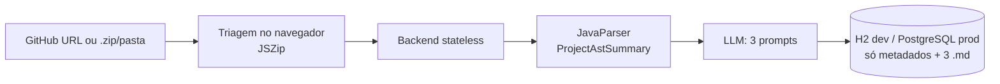

# SpringDocAI

> Documentação de integração **real**, extraída da AST do seu projeto Spring Boot — não de um prompt genérico.

Cole a URL de um repositório público do GitHub (ou solte um `.zip`/pasta) e receba três arquivos Markdown prontos para publicar:

| Arquivo | Para quê |
| :--- | :--- |
| `API-REFERENCE.md` | Rotas, parâmetros, validações Jakarta, payloads JSON de exemplo e códigos de erro derivados das exceções dos Services. |
| `INTEGRATION-GUIDE.md` | Casos de uso de negócio, ordem lógica de chamada dos endpoints e exemplos `cURL`. |
| `ARCHITECTURE.md` | Stack, pacotes, fluxo entre camadas e diagrama Mermaid das `@Entity`. |

## O problema

Times que herdam APIs Spring Boot legadas (ERPs com 50–80 endpoints) têm, no máximo, um Swagger com tipos primitivos: ele diz *o que* existe, mas não *em que ordem chamar*, nem *quais regras de negócio* se escondem nos Services. Enviar o código bruto para uma LLM estoura a janela de contexto, custa caro, alucina rotas — e é inaceitável para código privado.

## A solução: AST Stateless



1. **Client-side first:** o navegador descarta `src/test/`, `target/`, `.git/`, `.env`, binários e `.java` irrelevantes antes de qualquer upload.
2. **AST cirúrgica:** o [JavaParser](https://javaparser.org/) (Java 21) extrai só a estrutura — controllers, rotas (incluindo herança de classes base), services com `throw new`, DTOs/records com `jakarta.validation`, entidades JPA. Genéricos como `ResponseEntity<ApiResponse<MeuDTO>>` são desempacotados e Lombok/`record` são suportados.
3. **Zero-Retention:** o código-fonte vive **apenas em RAM** (`Map<String,String>` / `InputStream`). Nada de `.java` é gravado em disco ou no banco; só metadados do job e os 3 Markdowns finais são persistidos.
4. **Geração resiliente:** processamento assíncrono com *polling*, retentativa com backoff exponencial em 429/5xx e preservação dos documentos já gerados se um deles falhar.
5. **BYOK ou Mock:** chave via header `X-LLM-API-Key` > variável `LLM_API_KEY` > modo **Mock** determinístico (funciona sem nenhuma chave, ótimo para testar localmente).

## Stack

| Camada | Tecnologias |
| :--- | :--- |
| Backend | Java 21, Spring Boot 3.3, Spring Web, Spring Data JPA, Bean Validation, JavaParser 3.26, Lombok, Flyway |
| Banco | H2 em memória (`dev`/`test`, modo PostgreSQL) · PostgreSQL 16+ com Flyway (`prod`) |
| Frontend | Next.js 14 (App Router), React 18, TypeScript, Tailwind CSS, shadcn/ui (Radix), lucide-react, JSZip, react-markdown, Mermaid |
| Testes | JUnit 5, Mockito, `@DataJpaTest`, `@WebMvcTest`, `@SpringBootTest` (43 testes no backend) |

## Estrutura

```
backend/   Spring Boot (AST, ingestão em RAM, orquestração LLM, API REST, JPA)
frontend/  Next.js (landing + workspace de preview)
docs/      PRD, escopo, design e SDD (documento vivo com ADRs e changelog)
```

## Como rodar localmente

**Pré-requisitos:** JDK 21+ (o build mira Java 21, inclusive em JDK 23) e Node.js 20+.

### Backend (porta 8080, perfil `dev` com H2)

```bash
cd backend
./mvnw.cmd spring-boot:run        # Windows
mvn spring-boot:run               # com Maven instalado
```

- Console H2: <http://localhost:8080/h2-console> (`jdbc:h2:mem:springdocai`, usuário `sa`, sem senha).
- Variáveis opcionais: `LLM_API_KEY`, `LLM_BASE_URL` (padrão OpenAI), `LLM_MODEL`. Sem chave, roda em modo Mock.

### Frontend (porta 3000)

```bash
cd frontend
cp .env.example .env.local        # NEXT_PUBLIC_API_URL=http://localhost:8080
npm install
npm run dev
```

Abra <http://localhost:3000>, clique em uma pílula de exemplo (ex.: `spring-projects/spring-petclinic`) e acompanhe a geração.

### Testes e build

```bash
cd backend  && mvn clean test     # 43 testes
cd frontend && npm run build      # tipos + lint
```

### Produção

Use `SPRING_PROFILES_ACTIVE=prod` com `DB_URL`, `DB_USERNAME` e `DB_PASSWORD` apontando para um PostgreSQL 16+; o Flyway aplica `V1__create_tables.sql`.

## API

| Método | Rota | Descrição |
| :--- | :--- | :--- |
| `POST` | `/api/v1/generations/github` | Baixa o repositório público em RAM e inicia a geração. |
| `POST` | `/api/v1/generations/upload` | Recebe os arquivos já filtrados no cliente. |
| `GET` | `/api/v1/generations/{jobId}` | Status, métricas da AST e documentos gerados. |
| `GET` | `/api/v1/generations/history` | Últimas 20 gerações. |

Contratos completos em [`docs/SDD.md`](docs/SDD.md#5-contratos-de-api-rest-frontend---backend).

## Limitações conhecidas

- Foco exclusivo em Spring Boot (sem Quarkus/Micronaut nem outras linguagens).
- Repositórios privados: use o upload do `.zip` (não há OAuth com GitHub).
- O cliente de LLM fala o protocolo OpenAI Chat Completions; outros provedores exigem uma nova implementação de `LlmClient`.
- Projetos enormes (> 60.000 tokens de AST) ainda não são divididos em lotes (RNF02 pendente).

## Documentação do projeto

Decisões e histórico: [`docs/SDD.md`](docs/SDD.md) · Requisitos: [`docs/PRD.md`](docs/PRD.md) · Escopo: [`docs/MVP-SCOPE.md`](docs/MVP-SCOPE.md) · Design: [`docs/DESIGN-GUIDELINES.md`](docs/DESIGN-GUIDELINES.md)

