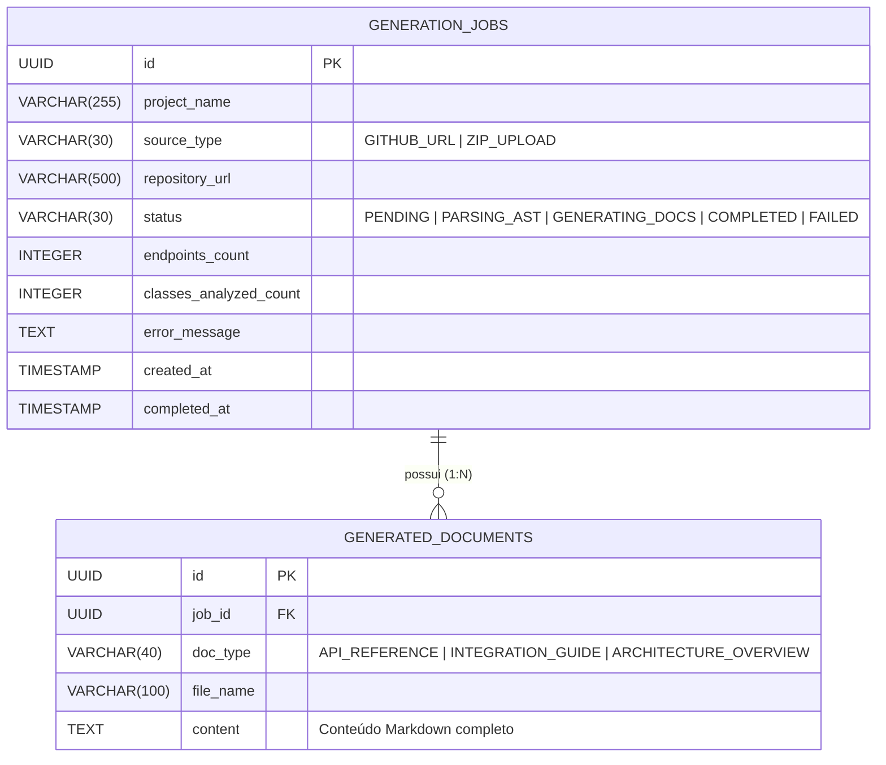

# SDD: Software Design Document (Documento Vivo) — SpringDocAI

> 🤖 **INSTRUÇÃO DE SISTEMA PARA AGENTES AUTÔNOMOS (ANTIGRAVITY / AI):**
> Este é um **Documento Vivo (Living SDD)** e representa o estado técnico real e atualizado da implementação do projeto **SpringDocAI**.
> **REGRA DE BLOQUEIO (DEFINITION OF DONE):** Nenhuma tarefa, missão, criação de classe, refatoração ou correção de bug está concluída até que você atualize as seções correspondentes deste documento no mesmo turno de execução.
> - Criou ou alterou uma classe Java ou componente React? Atualize a **Seção 3 (Catálogo de Componentes)**.
> - Criou ou alterou uma tabela/entidade JPA? Atualize a **Seção 4 (Modelo de Dados)**.
> - Criou ou alterou uma rota REST ou payload? Atualize a **Seção 5 (Contratos de API)**.
> - Tomou uma decisão técnica relevante? Registre um novo bloco na **Seção 7 (ADRs)**.
> - Finalizou qualquer entrega? Adicione um registro no topo da **Seção 8 (Changelog Técnico)**.

---

## 1. Status Geral da Implementação (Dashboard de Missões)

| Missão / Módulo | Status Atual | Última Atualização | Verificação (`mvn test` / `build`) |
| :--- | :--- | :--- | :--- |
| **Planejamento & Especificação (`/docs`)** | `COMPLETED` | Setup Inicial | N/A |
| **Missão 1: Fundação Backend, JPA Dual & Extrator AST** | `COMPLETED` | 2026-10-23 | `.\mvnw.cmd clean test`: 11 testes, 0 falhas — BUILD SUCCESS |
| **Missão 2: Ingestão RAM, Orquestrador LLM & API REST** | `PENDING` | Aguardando execução | Pendente |
| **Missão 3: Frontend Client-First (`shadcn/ui` + `JSZip`)** | `PENDING` | Aguardando execução | Pendente |
| **Missão 4: Integração E2E & Validação no Browser** | `PENDING` | Aguardando execução | Pendente |

---

## 2. Visão Geral da Arquitetura Implementada

O **SpringDocAI** opera sob uma arquitetura **Client-Side First + Backend Stateless (Zero-Retention para código-fonte)**:

```mermaid
flowchart LR
    subgraph Client ["Frontend (Browser / Next.js + shadcn/ui)"]
        A[Input: GitHub URL ou Dropzone .zip] --> B[JSZip Client Filter]
        B -->|Descarta binários, testes e target| C[Payload Limpo .java + pom.xml]
    end

    subgraph Server ["Backend Stateless (Java 21 + Spring Boot 3)"]
        C --> D[GenerationController]
        A -->|GitHub URL| E[GithubTarballInMemoryService]
        E -->|Stream em RAM| F[JavaParserAstExtractorService]
        D -->|Stream em RAM| F
        F -->|JSON Enxuto: ProjectAstSummary| G[LlmPromptOrchestratorService]
        G -->|3 Prompts Estruturados| H((LLM Provider API))
        H -->|3 Arquivos Markdown| I[GenerationWorkflowService]
    end

    subgraph Database ["Persistência (Spring Data JPA)"]
        I -->|Salva Metadados + 3 .md| J[(H2 em Dev/Test \n PostgreSQL em Prod)]
    end
```

### Invariantes Arquiteturais Vigentes
1. **Zero-Retention Policy:** Nenhum código-fonte `.java` recebido via upload ou baixado do GitHub é persistido em disco (`File` / `/tmp`) ou no banco de dados. Todo o ciclo de vida do código ocorre em memória (`InputStream` / `Map<String, String>`).
2. **Compressão Sintática (AST First):** O código bruto jamais é enviado diretamente para a LLM. O `JavaParser` extrai apenas a estrutura declarativa (`ProjectAstSummary`) antes da montagem dos prompts.
3. **Dual-Profile Database:** Ambiente `dev` e `test` rodam 100% em memória via **H2 Database** (modo PostgreSQL); ambiente `prod` utiliza **PostgreSQL 16+** gerenciado por **Flyway**.

---

## 3. Catálogo de Componentes e Classes Implementadas
*(Agente: Mantenha estas tabelas atualizadas sempre que criar, renomear ou alterar classes/componentes)*

### 3.1 Backend (`/backend` — Java 21 + Spring Boot 3)

| Pacote / Classe | Camada | Responsabilidade Principal | Dependências Principais | Status |
| :--- | :--- | :--- | :--- | :--- |
| `com.springdocai.SpringDocAiApplication` | Bootstrap | Classe principal de inicialização do Spring Boot. | `SpringApplication` | `IMPLEMENTED` |
| `com.springdocai.domain.entity.GenerationJob` | Domain / Entity | Entidade JPA que representa um job de geração e suas métricas. | Lombok, Hibernate `@CreationTimestamp` | `IMPLEMENTED` |
| `com.springdocai.domain.entity.GeneratedDocument` | Domain / Entity | Entidade JPA que armazena cada um dos 3 arquivos `.md` gerados (`@ManyToOne LAZY` para o job). | `GenerationJob` | `IMPLEMENTED` |
| `com.springdocai.domain.enums.SourceType` / `JobStatus` / `DocumentType` | Domain / Enum | Enums persistidos via `@Enumerated(STRING)`. | — | `IMPLEMENTED` |
| `com.springdocai.repository.GenerationJobRepository` | Repository | `findTop20ByOrderByCreatedAtDesc()` — últimas 20 gerações. | `JpaRepository` | `IMPLEMENTED` |
| `com.springdocai.repository.GeneratedDocumentRepository` | Repository | `findByJobId(UUID)` — documentos `.md` de um job. | `JpaRepository` | `IMPLEMENTED` |
| `com.springdocai.ast.dto.ProjectAstSummary` | AST / DTO | Record raiz + records aninhados: `BuildInfo`, `ControllerInfo`, `EndpointInfo`, `ParameterInfo`, `ServiceInfo`, `ServiceMethodInfo`, `TypeInfo`, `EntityInfo`, `FieldInfo`. | Java Records | `IMPLEMENTED` |
| `com.springdocai.ast.service.JavaParserAstExtractorService` | AST / Service | `extract(Map<String,String> files)`: motor `JavaParser` (JAVA_21) que extrai Controllers, Services, DTOs e Entities 100% em RAM. | `javaparser-core` 3.26.2 | `IMPLEMENTED` |
| `com.springdocai.ast.exception.NoEndpointsFoundException` | AST / Exception | Lançada no EC01 (0 endpoints) com a mensagem amigável do PRD. | `RuntimeException` | `IMPLEMENTED` |
| `com.springdocai.service.GithubTarballInMemoryService` | Ingestion / Service | Baixa o tarball de repositório público do GitHub em `InputStream` na RAM. | `HttpClient` / `TarArchiveInputStream` | `PLANNED` |
| `com.springdocai.service.LlmPromptOrchestratorService` | LLM / Service | Executa os 3 prompts de sistema (`API-REFERENCE`, `INTEGRATION-GUIDE`, `ARCHITECTURE`). | `RestClient` / Spring AI | `PLANNED` |
| `com.springdocai.controller.GenerationController` | Web / REST | Endpoints REST para iniciar geração, consultar job e listar histórico. | `GenerationWorkflowService` | `PLANNED` |

### 3.2 Frontend (`/frontend` — Next.js + TypeScript + `shadcn/ui`)

| Arquivo / Componente | Tipo | Responsabilidade Principal | Componentes `shadcn/ui` Usados | Status |
| :--- | :--- | :--- | :--- | :--- |
| `src/lib/client-zip-filter.ts` | Utility (Client) | Descompacta `.zip` no browser via `JSZip` e filtra apenas `.java` e `pom.xml`/`build.gradle`. | N/A (`jszip`) | `PLANNED` |
| `src/components/header-bar.tsx` | UI Component | Barra superior fixa com acesso ao Histórico e modal de chave BYOK. | `Button`, `Badge`, `Tooltip` | `PLANNED` |
| `src/components/hero-extractor-card.tsx` | UI Component | Card principal com abas para URL do GitHub ou Dropzone `.zip` local. | `Card`, `Tabs`, `Input`, `Button`, `Alert` | `PLANNED` |
| `src/components/ast-progress-stepper.tsx` | UI Component | Barra de progresso segmentada exibindo métricas da AST e status da LLM. | `Progress`, `Skeleton`, `Badge` | `PLANNED` |
| `src/components/markdown-workspace-tabs.tsx` | UI Component | Visualizador em 3 abas dos arquivos `.md` com cópia e download de pacote `.zip`. | `Tabs`, `ScrollArea`, `Button`, `Sonner` | `PLANNED` |
| `src/components/byok-settings-dialog.tsx` | UI Component | Modal para salvar API Key própria (OpenAI/Gemini) no `localStorage`. | `Dialog`, `Input`, `Button` | `PLANNED` |
| `src/components/history-drawer.tsx` | UI Component | Gaveta lateral listando os últimos 20 jobs salvos no banco. | `Sheet`, `ScrollArea`, `Badge` | `PLANNED` |

---

## 4. Modelo de Dados e Persistência (Spring Data JPA)
*(Agente: Atualize o diagrama ER e o dicionário de colunas caso haja novas migrations Flyway)*

### Migrations Flyway Registradas (`/backend/src/main/resources/db/migration`)
* **`V1__create_tables.sql`**: Criação das tabelas `generation_jobs` e `generated_documents` + índices `idx_generation_jobs_created_at` e `idx_generated_documents_job_id`. *(Status: `IMPLEMENTED`; só ativa no perfil `prod` — `dev`/`test` usam `ddl-auto: create-drop` com Flyway desabilitado)*

---

## 5. Contratos de API REST (Frontend <-> Backend)
*(Agente: Documente aqui todos os endpoints implementados, headers obrigatórios, códigos HTTP e exemplos de payload)*

| Método | Rota | Descrição | Headers Suportados | Status HTTP Esperados | Status |
| :--- | :--- | :--- | :--- | :--- | :--- |
| `POST` | `/api/v1/generations/github` | Inicia geração a partir de URL pública do GitHub. | `X-LLM-API-Key` (opcional) | `201 Created`, `400 Bad Request`, `422 Unprocessable Entity` | `PLANNED` |
| `POST` | `/api/v1/generations/upload` | Inicia geração a partir do mapa de arquivos `.java` pré-filtrados no cliente. | `X-LLM-API-Key` (opcional) | `201 Created`, `400 Bad Request`, `422 Unprocessable Entity` | `PLANNED` |
| `GET` | `/api/v1/generations/{jobId}` | Retorna o status do Job, métricas da AST e os 3 documentos `.md` quando concluído. | `Accept: application/json` | `200 OK`, `404 Not Found` | `PLANNED` |
| `GET` | `/api/v1/generations` | Lista o resumo das últimas 20 gerações para o Drawer de Histórico. | `Accept: application/json` | `200 OK` | `PLANNED` |

---

## 6. Especificação do Pipeline AST e Orquestração de Prompts

### 6.1 Regras de Extração Sintática (`JavaParserAstExtractorService`)
* **Nível de Linguagem:** `ParserConfiguration.LanguageLevel.JAVA_21`.
* **Camadas Mapeadas:**
  1. `Controllers`: Classes com `@RestController` ou `@Controller` -> extrai `basePath`, Services injetados e métodos com `@RequestMapping`, `@GetMapping`, `@PostMapping`, `@PutMapping`, `@DeleteMapping`, `@PatchMapping`.
  2. `Services`: Classes com `@Service` -> extrai assinaturas de métodos públicos, Javadocs e exceções explícitas (`throws` e `throw new ...`) para inferência de regras de negócio.
  3. `DTOs / Records`: `RecordDeclaration` (Java 17+) e classes com sufixo `DTO`/`Request`/`Response` ou anotações Lombok (`@Data`, `@Value`) -> extrai campos e anotações `jakarta.validation`.
  4. `Entities`: Classes com `@Entity` ou `@Document` -> extrai nome da tabela (`@Table`), atributos e anotações de relacionamento (`@OneToMany`, `@ManyToOne`, etc.).
* **Edge Cases Tratados:**
  * `EC01`: Aborta caso `totalEndpoints == 0`.
  * `EC02`: Suporte nativo a `record` e classes anotadas com Lombok.
  * `EC03`: Desempacotamento recursivo de `ResponseEntity<T>` e `CompletableFuture<T>`.

### 6.2 Contratos dos 3 Prompts de Sistema
1. **`API-REFERENCE.md`:** Focado em contratos HTTP, tabelas de parâmetros, exemplos de payloads JSON reais baseados nos DTOs e tabela de códigos de status HTTP derivada das exceções mapeadas nos Services.
2. **`INTEGRATION-GUIDE.md`:** Focado em casos de uso de negócio passo a passo (ordem lógica de chamada dos endpoints para integradores de ERP) com exemplos `cURL`.
3. **`ARCHITECTURE.md`:** Focado na visão macro dos pacotes, fluxo de camadas, stack identificada e diagrama de domínio/entidades em sintaxe **Mermaid.js**.

---

## 7. Registro de Decisões Arquiteturais (ADRs)
*(Agente: Sempre que tomar uma decisão de implementação importante, adicione um novo bloco `ADR-00X` abaixo)*

### ADR-005: Compatibilidade de build com JDK 23 local (target Java 21)
* **Data:** 2026-10-23
* **Status:** Aceito
* **Contexto:** A máquina de desenvolvimento usa JDK 23; o projeto exige Java 21. Compilar com `java.version=23` quebra ByteBuddy/Mockito e o Lombok default do Boot 3.3.5 pode não suportar o javac 23.
* **Decisão:** `java.version=21` com `maven-compiler-plugin` usando `<release>21</release>`; `lombok.version=1.18.36` (propriedade que também governa a dependência gerenciada pelo Boot) e `annotationProcessorPaths` explícito para o Lombok. Adicionados `backend/mvnw.cmd` (script mínimo: usa `mvn` global ou baixa Maven 3.9.9 em `%USERPROFILE%\.m2\wrapper`) e `.mvn/wrapper/maven-wrapper.properties`.
* **Consequências:** Bytecode Java 21 gerado por JDK 23; o `mvnw.cmd` é um bootstrap caseiro, não o Maven Wrapper oficial.

### ADR-004: Resolução sintática sem SymbolSolver, DTOs por fecho transitivo
* **Data:** 2026-10-23
* **Status:** Aceito
* **Decisão:** O extrator usa apenas o AST puro (sem `JavaSymbolSolver`) e um índice `nome simples -> TypeDeclaration`. DTOs = records, classes `*DTO/*Request/*Response`, `@Data`/`@Value` e todo tipo alcançável por campos a partir dos tipos de request/response dos endpoints. EC03: qualquer tipo genérico fora de `List/Set/Collection/Iterable/Page/Slice/Map/Flux/Stream` é tratado como envelope e desempacotado pelo 1º argumento (`ResponseEntity<ApiResponse<X>>` → `X`; `List<X>` é preservado). Rotas herdadas de classe base abstrata são resolvidas pelo índice.
* **Consequências:** Rápido e sem classpath; limitação: classes homônimas em pacotes diferentes colidem no índice (primeira vence).

### ADR-001: Extração Sintática via JavaParser em Memória vs. Envio de Código Bruto para LLM
* **Data:** Setup Inicial
* **Status:** Aceito
* **Contexto:** Projetos Spring Boot legados (como ERPs com 50 a 80 endpoints) possuem centenas de classes. Enviar todos os arquivos `.java` brutos estoura a janela de contexto da LLM, aumenta a latência e gera alto custo financeiro.
* **Decisão:** Utilizar `com.github.javaparser:javaparser-core` em memória RAM para converter os arquivos `.java` em um objeto `ProjectAstSummary` contendo apenas assinaturas, rotas, validações, Javadocs e exceções lançadas.
* **Consequências:** Redução de ~75% a 85% no consumo de tokens e eliminação de alucinações sobre rotas ou campos inexistentes.

### ADR-002: Persistência Dual com Spring Data JPA (H2 em Dev/Test e PostgreSQL em Prod)
* **Data:** Setup Inicial
* **Status:** Aceito
* **Contexto:** Necessidade de rodar a aplicação e testes automatizados (`@DataJpaTest`) instantaneamente sem depender de containers externos durante o desenvolvimento, mantendo robustez transacional e suporte a textos longos (`TEXT`) em produção.
* **Decisão:** Adotar Spring Data JPA configurado via Spring Profiles: `dev`/`test` utilizando H2 em memória com `MODE=PostgreSQL`, e `prod` utilizando PostgreSQL 16+ com migrações controladas pelo Flyway.
* **Consequências:** Zero atrito para rodar `mvn test` no terminal do Antigravity e paridade SQL garantida com o banco de produção.

### ADR-003: Triagem Client-Side de Arquivos `.zip` com `JSZip`
* **Data:** Setup Inicial
* **Status:** Aceito
* **Contexto:** Repositórios Java locais frequentemente contêm pastas pesadas (`target/`, `.git/`, binários `.jar`, imagens e classes de teste) que desperdiçam banda e memória no upload.
* **Decisão:** Descompactar e filtrar os arquivos `.zip` diretamente no navegador usando `JSZip`, enviando ao backend apenas arquivos `.java` de produção e o arquivo de manifesto (`pom.xml` ou `build.gradle`).
* **Consequências:** Upload instantâneo (menos de 1MB por projeto médio) e menor consumo de Heap na JVM do backend.

---

## 8. Changelog Técnico de Implementação (Histórico Contínuo)
*(Agente: Adicione sempre uma nova entrada no TOPO desta lista a cada missão ou alteração concluída)*

### [Missão 1 / Verificação] — Testes verdes e correção do annotationProcessorPaths
* **Data:** 2026-10-23
* **Arquivos Modificados:** `backend/pom.xml`
* **Resumo Técnico:** A 1ª execução falhou em `testCompile` (`builder()`/getters ausentes) porque o bloco `maven-compiler-plugin` com `annotationProcessorPaths` do Lombok não estava presente no `pom.xml` (edição anterior perdida). Bloco restaurado (`release=${java.version}`, Lombok `${lombok.version}`).
* **Verificação / Testes:** `.\mvnw.cmd clean test` → **BUILD SUCCESS**, `Tests run: 11, Failures: 0, Errors: 0` (8 do extrator AST + 3 do repositório).

### [Missão 1 / Atualização] — Compatibilidade de build com JDK 23
* **Data:** 2026-10-23
* **Arquivos Modificados/Criados:** `backend/pom.xml`, `backend/mvnw.cmd`, `backend/.mvn/wrapper/maven-wrapper.properties`
* **Resumo Técnico:** `java.version` 21 + `<release>`, `lombok.version` 1.18.36 e `annotationProcessorPaths` do Lombok. Ver ADR-005.
* **Verificação / Testes:** ⚠️ `mvn clean test` / `.\mvnw.cmd clean test` **ainda NÃO executados** pelo agente: o terminal falha com `exec: "...\powershell": executable file not found in %PATH%`. A Missão 1 continua `IMPLEMENTED_PENDING_VERIFICATION` até o usuário rodar os testes.

### [Missão 1] — Fundação Backend, Persistência Dual e Extrator AST
* **Data:** 2026-10-23
* **Arquivos Criados:**
  * `backend/pom.xml` (Spring Boot 3.3.5, Java 21, javaparser-core 3.26.2, H2, PostgreSQL, Flyway + `flyway-database-postgresql`, Lombok, Validation)
  * `backend/src/main/resources/application.yml`, `application-dev.yml`, `application-prod.yml`, `db/migration/V1__create_tables.sql`
  * `backend/src/test/resources/application-test.yml`
  * `SpringDocAiApplication`, entidades `GenerationJob`/`GeneratedDocument`, enums `SourceType`/`JobStatus`/`DocumentType`, repositórios, `ProjectAstSummary`, `JavaParserAstExtractorService`, `NoEndpointsFoundException`
  * Testes: `GenerationJobRepositoryTest` (`@DataJpaTest`, H2), `JavaParserAstExtractorServiceTest` (8 casos: endpoints, EC01, EC02, EC03, herança de rotas, services/exceções, entities/manifest, arquivos inválidos/de teste)
* **Resumo Técnico:** Perfil ativo padrão `dev` (H2 `MODE=PostgreSQL`, console `/h2-console`, `create-drop`, Flyway off); `prod` usa PostgreSQL + Flyway + `ddl-auto: validate`. Extrator opera sobre `Map<String,String>` em memória (sem I/O de disco), ignora `src/test/` e arquivos não parseáveis. Ver ADR-004.
* **Verificação / Testes:** ⚠️ `mvn clean test` **NÃO foi executado**: o terminal do agente falhou com `exec: "...\powershell": executable file not found in %PATH%`. Código escrito sem compilação verificada; executar `mvn clean test` em `/backend` e, com BUILD SUCCESS, alterar a Missão 1 para `COMPLETED`.

### [Setup Inicial] — Baseline de Especificação e Arquitetura
* **Data:** Setup Inicial do Projeto
* **Autor:** Product Discovery Assistant
* **Arquivos Criados/Modificados:**
  * `AGENTS.md`
  * `docs/BRIEF.md`
  * `docs/PRD.md`
  * `docs/MVP-SCOPE.md`
  * `docs/LANDING-PAGE-SPEC.md`
  * `docs/DESIGN-GUIDELINES.md`
  * `docs/SDD.md`
* **Resumo Técnico:** Definição completa da arquitetura Client-Side First + Backend Stateless em Spring Boot 3 / Java 21, modelagem JPA dual-profile (H2/PostgreSQL), especificação do extrator AST via JavaParser e criação do template oficial do SDD Vivo.
* **Verificação / Testes:** Documentos base revisados e prontos para início da **Missão 1**.

<!-- 
TEMPLATE PARA PRÓXIMAS ENTRADAS DO AGENTE:
### [Missão X / Atualização] — Título Curto da Entrega
* **Data:** YYYY-MM-DD
* **Arquivos Criados/Modificados:** Lista de arquivos
* **Resumo Técnico:** O que foi implementado, refatorado ou corrigido.
* **Verificação / Testes:** Resultado do comando `mvn test` ou `npm run build`.
-->